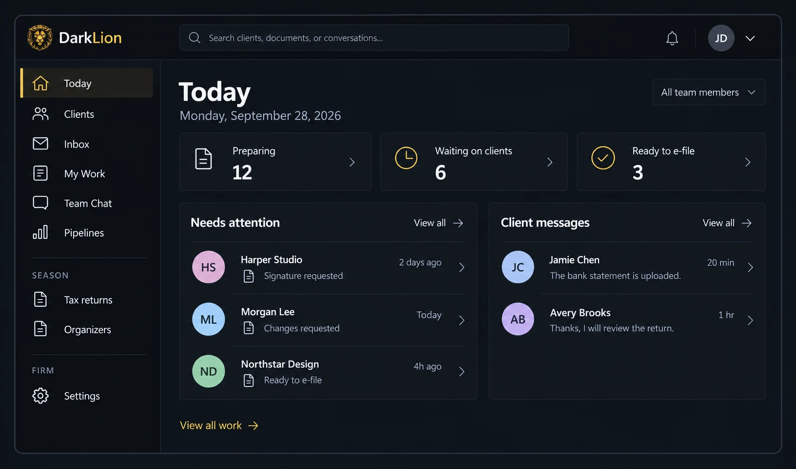
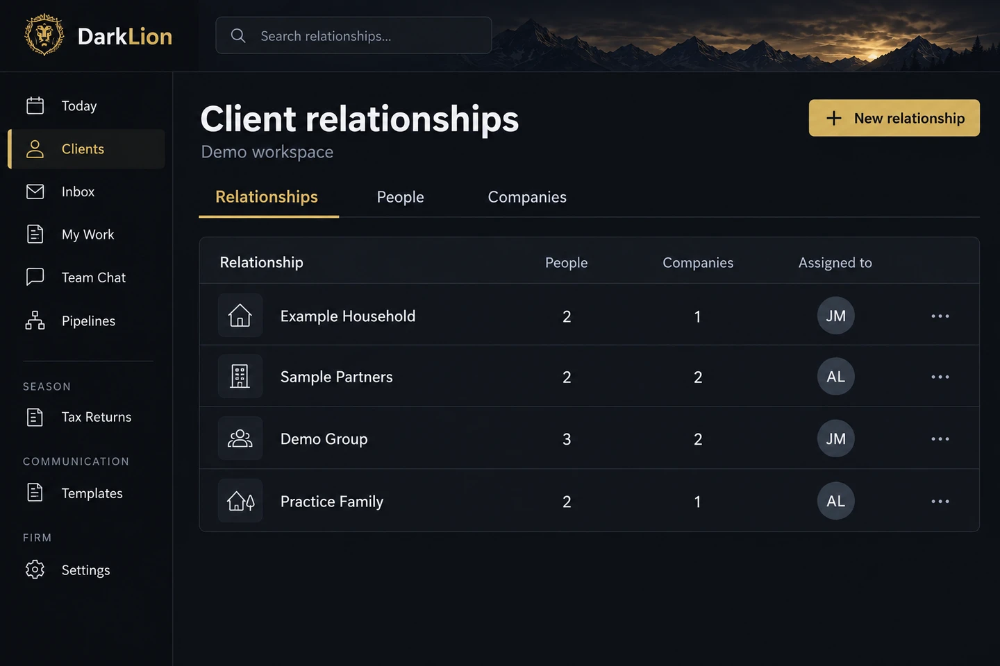
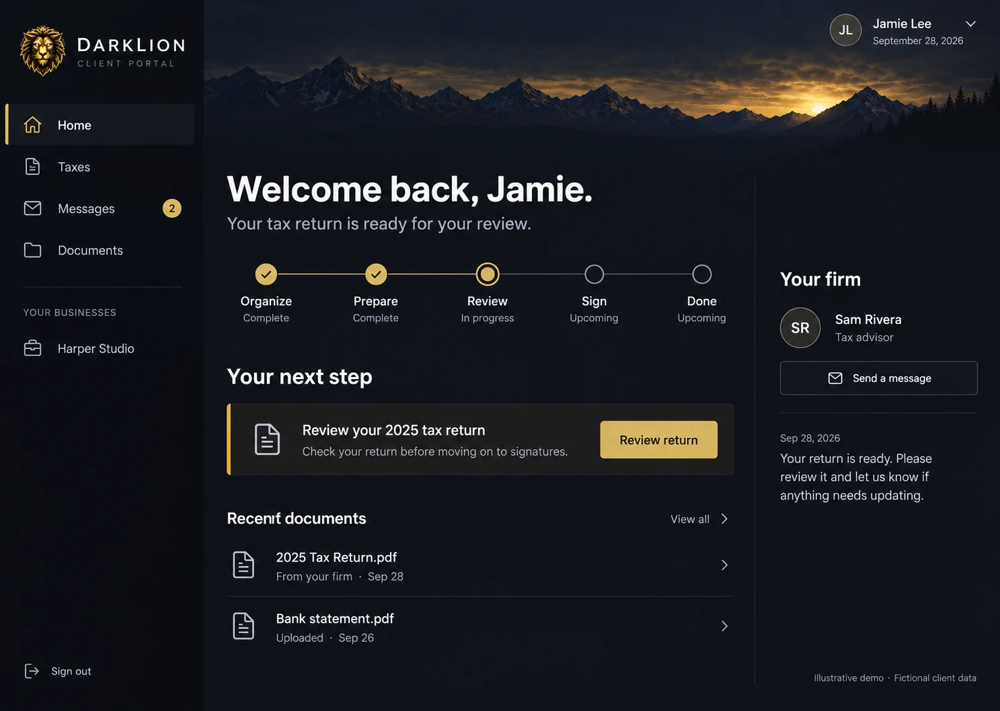
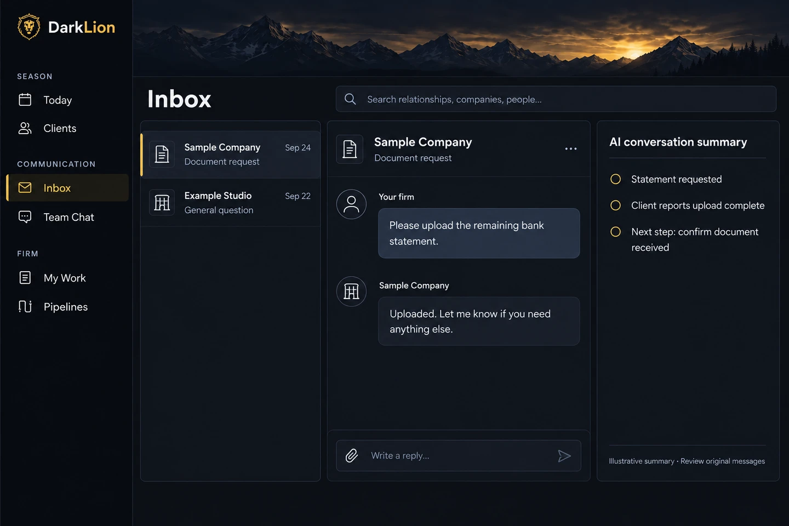
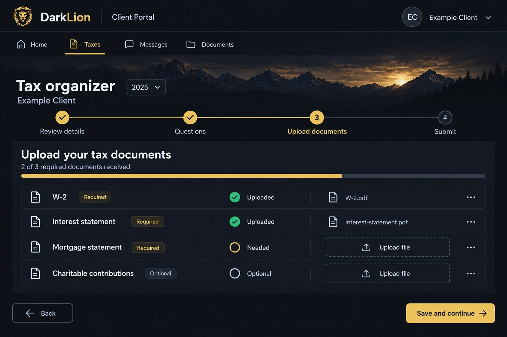
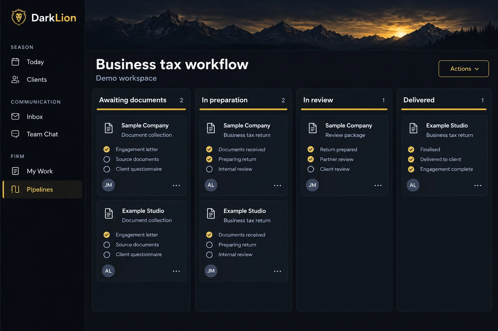
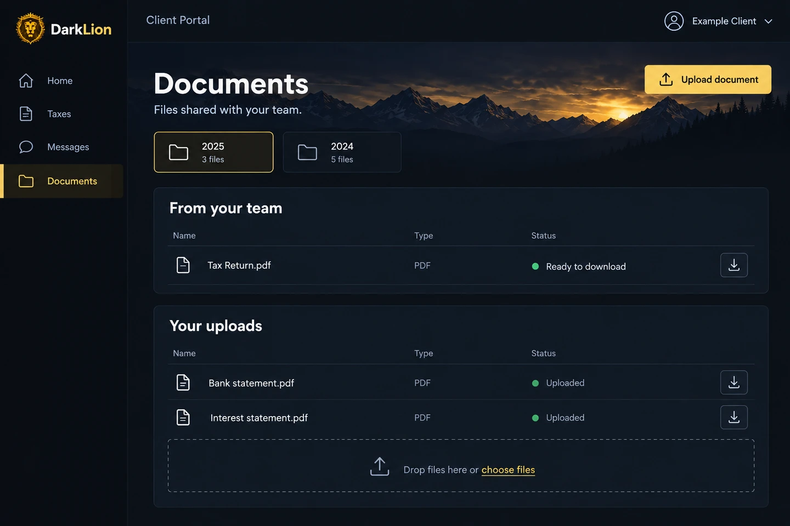
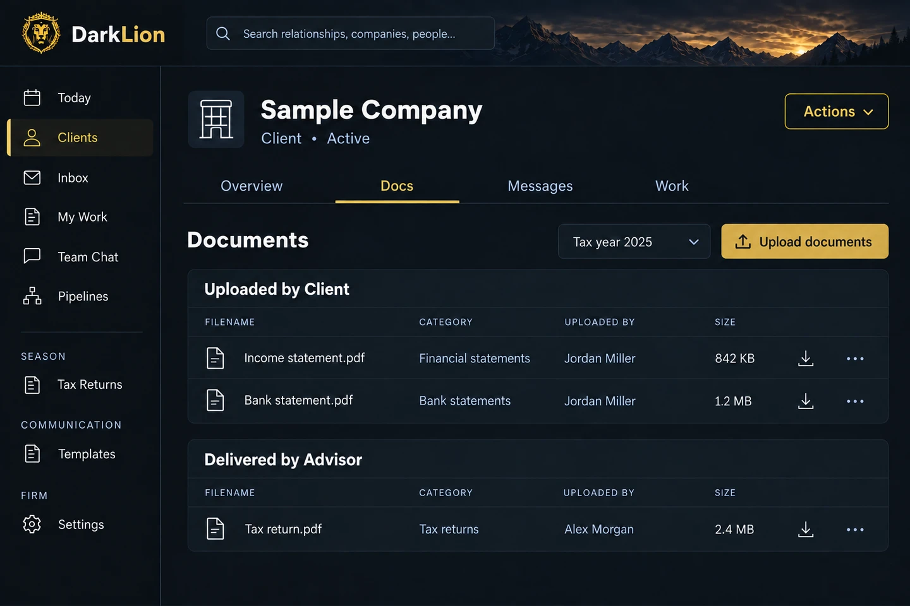
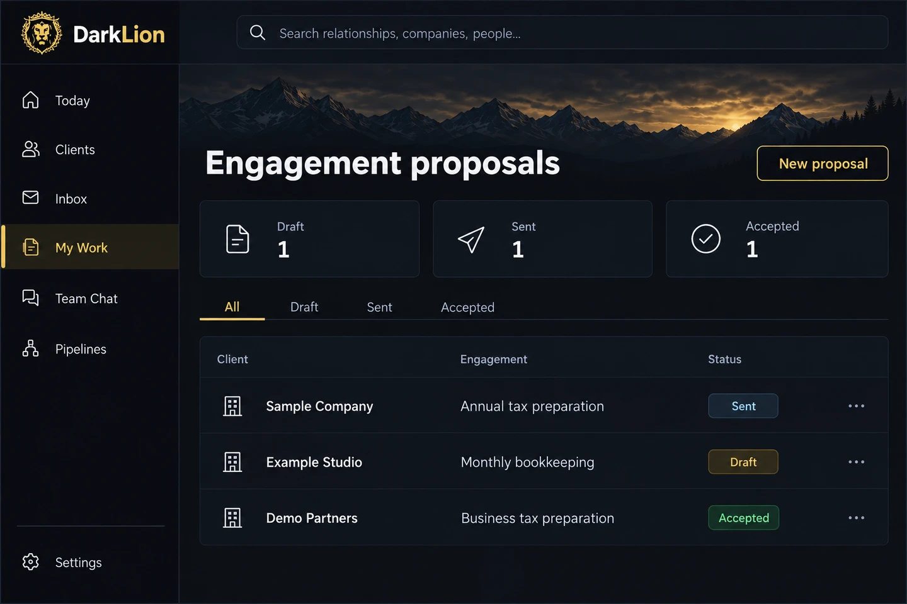
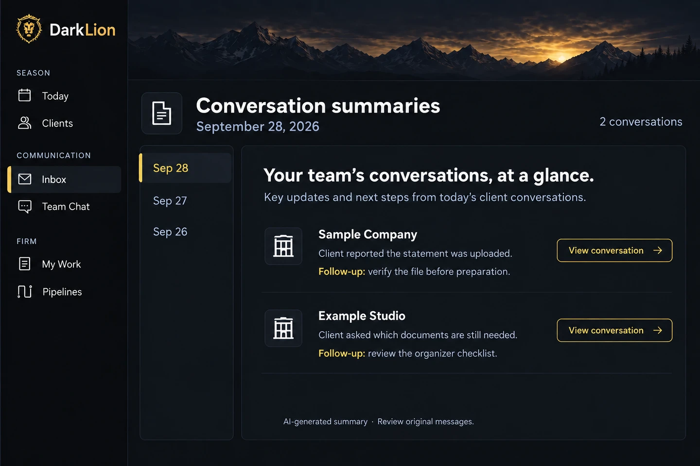

# DarkLion

Practice management for tax and advisory firms: client records, CRM, secure client portal, documents, messaging, tax organizers, return delivery with e-signature, proposals and engagement letters, team chat, and optional AI assistance. Includes an Expo mobile client app you can brand as your own.

**Built by [LedgerHQ](https://ledgerhq.ai) and given away free.**



> DarkLion is provided **as is**, with no warranty and no support. It was built for and run by a working firm. You host it, you own your data, and you are responsible for security, backups, and compliance (IRS Pub 4557, FTC Safeguards Rule, your state rules). If you want it to work differently, change it. It is a normal Node.js app and an AI coding agent can modify it easily.

## Screenshots

All screens show fictional demo data.

| Staff workspace | Client portal |
| --- | --- |
| <br>**Clients.** People, companies, documents, and history in one record. | <br>**Client home.** Each client sees where their return stands and what to do next. |
| <br>**Inbox.** Client conversations with attachments and optional AI summaries. | <br>**Tax organizer.** Clients answer questions and upload what you need. |
| <br>**Pipelines.** Your own stages, assignments, and checklists. | <br>**Client documents.** Delivered returns and client uploads, by year. |
| <br>**Documents.** Files filed to the right client, year, and category. | <br>**Proposals.** Engagement letters from draft to accepted. |
| <br>**Daily summaries.** What clients said today and the follow-ups. | |

## Quick start (local)

Requires Node 20+ and Postgres 15+. In production you also need S3-compatible storage, Chromium for PDFs (included in the Dockerfile), and Resend for email. Pusher (live updates) and inbound email replies are optional. The full list of software and services is in [docs/self-hosting.md](docs/self-hosting.md#software-you-need).

```bash
git clone https://github.com/ChrisRagainTR/darklion.git
cd darklion
npm ci
cp .env.example .env      # fill in DATABASE_URL, JWT_SECRET, ENCRYPTION_KEY, APP_URL
set -a; . ./.env; set +a
npm start                 # creates the database tables on first boot
# in another terminal, with the same env loaded:
FIRM_NAME="Smith & Co. CPAs" OWNER_NAME="Jane Smith" OWNER_EMAIL=jane@yourfirm.com \
OWNER_PASSWORD='a-long-password' npm run bootstrap
```

Open http://localhost:8080/login and sign in as the owner.

## Guides

- [Self-hosting in production](docs/self-hosting.md): hosting, database, storage, email, custom domains, backups
- [AI setup](docs/ai-setup.md): keys, costs, and running with AI turned off
- [Branding the mobile app](docs/mobile-branding.md)
- [API and MCP](docs/api-docs.md)

## Layout

| Path | What it is |
| --- | --- |
| `server/` | Express app, routes, services, EJS views. `server/db.js` is the schema. |
| `public/` | Static pages and client portal assets |
| `mobile/` | Expo / React Native client app |
| `darklion-print-agent/`, `darklion-drive/`, `apps/desktop/` | Optional desktop helpers |
| `inference/` | Optional self-hosted AI inference service |
| `tests/` | Unit tests (`npm run test:local`) and Playwright tests (`npm test`) |

## License

[GNU AGPL v3](LICENSE). You may use, modify, and host DarkLion for your firm for free. If you offer a modified version to others over a network, you must share your source under the same license.

## Security

See [SECURITY.md](SECURITY.md).
